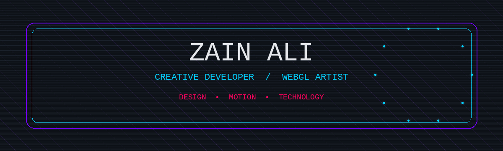
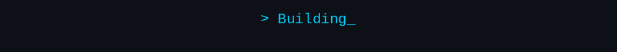
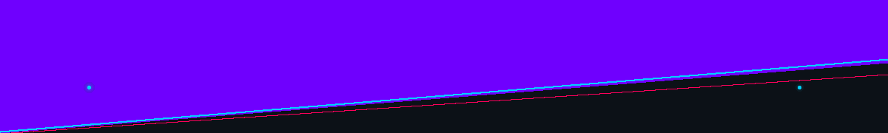

<p align="center"><a href="https://zaindev.me"></a></p>

<p align="center"><a href="https://zaindev.me"></a></p>

<p align="center">
  
  
  
</p>
<p align="center">
  <a href="https://zaindev.me/?utm_source=github&utm_medium=profile_readme&utm_campaign=readme"></a>
  <a href="https://linkedin.com/in/usernamezain"></a>
  <a href="https://whatsapp.com/channel/0029VbBUVv35fM5eAnXw3w2D"></a>
  <a href="mailto:your-email@example.com"></a>
</p>

## About

> I build digital experiences where design, motion, and technology feel like one.

Building immersive products at [Zain Ali's creative developer portfolio](https://zaindev.me).
- **Building:** Mughal.Dev, a 3D portfolio with WebGL shaders and interactive scenes.
- **Exploring:** WebGPU, React Server Components, and AI-driven UI.
- **Open to:** creative coding collaborations and frontend opportunities.

<picture>
  <source media="(prefers-color-scheme: dark)" srcset="https://raw.githubusercontent.com/usernamezain/usernamezain/output/github-contribution-grid-snake-dark.svg" />
  
</picture>

## Tech Stack

<p align="center">
  <br/>
  <br/>
  <br/>
  
</p>
<p align="center"><sub>3D → Frameworks → Languages & runtime → Foundations</sub><br/><sub><b>Also:</b> GSAP, Framer Motion, React Three Fiber, WebGL / GLSL, GraphQL, Docker, Figma, Git</sub></p>

## Featured Work

Explore [immersive 3D web experiences by Zain Ali](https://zaindev.me) and selected builds:
<table><tr>
<td width="33%" valign="top"><b><a href="https://github.com/usernamezain/mughal-dev">Mughal.Dev</a></b><br/>3D immersive portfolio with WebGL shaders and interactive scenes.<br/><sub>`Three.js` `R3F` `GSAP`</sub><br/><a href="https://github.com/usernamezain/mughal-dev">View repository</a></td>
<td width="33%" valign="top"><b><a href="https://ultimate-empire.online">Ultimate Empire</a></b><br/>Organic social growth platform with fluid smooth scrolling.<br/><sub>`React` `GSAP` `Lenis`</sub><br/><a href="https://github.com/usernamezain/ultimate-empire">View repository</a></td>
<td width="33%" valign="top"><b><a href="https://bukharidesign.com">Bukhari Designers</a></b><br/>Premium agency site for global graphic and UI/UX services.<br/><sub>`React` `TypeScript` `Lenis`</sub><br/><a href="https://github.com/usernamezain/bukhari-designers">View repository</a></td>
</tr></table>

## GitHub Stats

<p align="center"> </p>

## Let's Build Something

<p align="center"><a href="https://zaindev.me/?utm_source=github&utm_medium=profile_readme&utm_campaign=readme"></a> <a href="https://zaindev.me/?utm_source=github&utm_medium=profile_readme&utm_campaign=readme"></a></p>
<p align="center"><a href="https://zaindev.me"></a></p>

## Local animation system

The header, typing banner, and footer are deterministic Pillow GIFs generated locally. No remote image service is needed for these animations.

```bash
python -m pip install -r requirements.txt
python generate.py
python validate.py
```

`generate.py` is reproducible and `validate.py` checks dimensions, frame counts, file-size budgets, and README references. GitHub Actions regenerates and validates the assets when their source changes.
